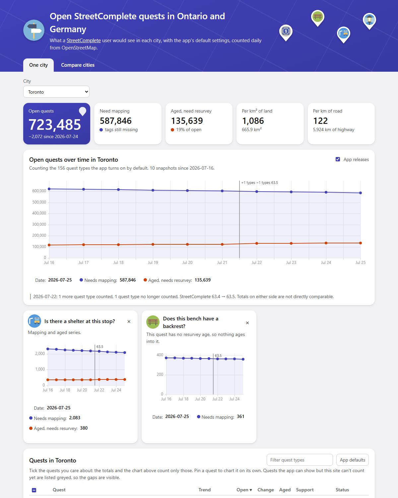

# sc-open-quests

How many [StreetComplete](https://streetcomplete.app/) quests are open in each Ontario city, by quest
type, and how that changes day to day. Each number is what a StreetComplete user standing in that city
would see, with the app's default settings, on a pinned app version. Live site:
https://skfd.github.io/sc-open-quests/ (GitHub Pages from `docs/`).

This project is **read-only**: it never edits OpenStreetMap.

## How it works

1. **Quest definitions come from the app's own build.** `tools/sc-harness` dumps every quest's resolved
   element filter from StreetComplete into `data/quests/v<SC>.json`. Nothing is hand-written.
2. **The engine** (`engine/`, Kotlin on the JVM, running StreetComplete's own filter code) reads the
   Geofabrik Ontario extract and counts each quest per city polygon (`config/cities.json`, 48
   municipalities). It writes one snapshot per extract to `docs/data/snapshots/<asOfDate>.json`.
3. **`run.py history`** rebuilds the per-city time series in `docs/data/history/` and the city index
   `docs/data/cities.json` from all snapshots.
4. **The site** (`docs/index.html`, no build step) reads that JSON.

Quests the app shows but this site can't count yet are listed on the page, greyed, with their status.
Quests that reopen only because a check date aged ("needs resurvey") are counted apart from ones that
still need mapping. See [DESIGN.md](DESIGN.md) for the method and [DATA-FORMAT.md](DATA-FORMAT.md) for
the JSON.

## Setup

- Python 3.11+ (standard library only, no venv needed).
- JDK 21 for the engine. `run.py` uses Android Studio's bundled JBR
  (`C:\Program Files\Android\Android Studio\jbr`) when it exists, otherwise your `JAVA_HOME`.
  `count` builds the engine (`engine\gradlew.bat installDist`) when it is missing or older than its
  sources.
- About 12 GB of free RAM for a full Ontario pass.
- Extracts come from the shared store `~/Code/.osm-data`, managed by `~/Code/osm-extracts`
  (override with `OSM_DATA_DIR` / `OSM_EXTRACTS_TOOL`). This project never downloads a PBF itself.

## Usage

```bash
python run.py download   # osm-extracts fetch ontario (it skips an unchanged extract)
python run.py count      # engine on the newest extract -> docs/data/snapshots/<asOfDate>.json (skipped if counted)
python run.py backfill   # count every dated extract still in the store
python run.py history    # snapshots -> docs/data/history/<city>.json + docs/data/cities.json
python run.py update     # all three, then commit "data <asOfDate>" and push
```

`update` is the scheduled entry point. A second run on the same extract downloads nothing, counts
nothing and commits nothing. `count --force` recounts.

Tests: `python -m unittest`.

To preview the site, serve the repo root (`python -m http.server`) and open `/docs/`. Before the
engine has published `docs/data/`, point it at the fixture:
`/docs/?data=../tests/fixtures/data` (regenerate with `python tests/fixtures/make_site_fixture.py`).



## Scheduling (Windows)

Two PowerShell scripts manage a Task Scheduler entry. Run them as Administrator.

```powershell
.\schedule-add.ps1      # daily at 13:15, appends to logs\scheduler.log
.\schedule-remove.ps1
```

The task is named `kk-SCOpenQuests`. It starts when available if the machine was off at 13:15 and
is stopped after two hours.

## Licence and attribution

- Code: [GPL-3.0](LICENSE). The engine links StreetComplete's source (GPL-3.0), so the whole project
  is GPL-3.0.
- Map data: © [OpenStreetMap contributors](https://www.openstreetmap.org/copyright), ODbL 1.0.
  Extract by [Geofabrik](https://download.geofabrik.de/).
- City boundaries: from the OpenStreetMap relations listed in `config/cities.json`.
