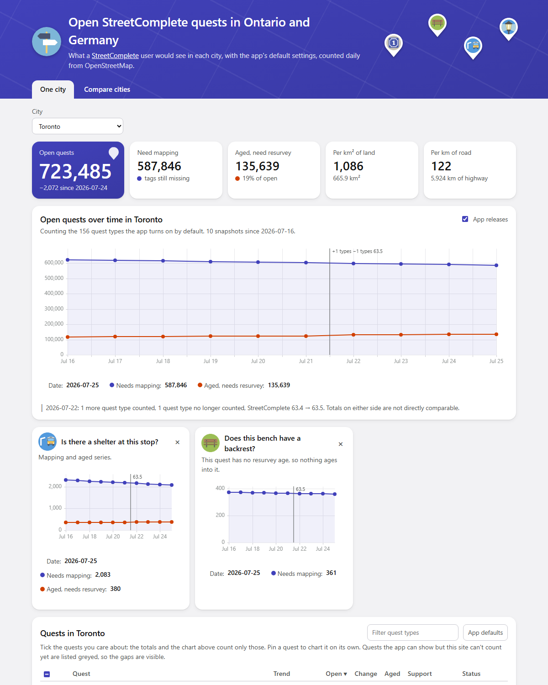

# sc-open-quests

How many [StreetComplete](https://streetcomplete.app/) quests are open in each Canadian city over 50,000 people (and in
Berlin, Hamburg and Bremen), by quest type, and how that changes day to day. Each number is what a StreetComplete user standing in that city
would see, with the app's default settings, on a pinned app version. Live site:
https://skfd.github.io/sc-open-quests/ (GitHub Pages from `docs/`).

This project is **read-only**: it never edits OpenStreetMap.

## Goals

The original brief (2026-10-11), verbatim. Corrected the same day: StreetComplete statistics do exist elsewhere
(starsep/StreetCompleteStats, see PRIOR-ART.md), and Toronto is admin_level 6. The project has since grown from
Toronto to Canada, three German city-states and the world (journal/2026-10-11-the-brief.md and later entries).

### Goal
Build a public website that graphs **open StreetComplete quests per city over time, broken down by quest type**. As far as we know, nothing like it exists. jmizv's sc-quest-stats on Codeberg is a static, single-city Markdown snapshot. Pilot city: **Toronto**.

### What the site should answer
- How many quests of each type are open in city X right now?
- How has that changed over time? Which types are being solved, which are piling up?
- How do cities compare, normalized so size doesn't dominate?
- Where in the city is a given quest type concentrated? (stretch goal: map/heatmap)

### High-level goals
1. **Reuse StreetComplete's own quest definitions.** Don't hand-write Overpass queries. Most quest types declare an element filter string in their Kotlin source (`streetcomplete/StreetComplete`, `quests/**`). Extract and parse those so the tool stays in sync with app releases. Pin the app version used for each data run.
2. **Be honest about coverage.** Some quests aren't pure tag filters: resurvey intervals based on `check_date` age, country-specific enablement, geometry or nearby-feature checks. Classify each quest type as *supported*, *approximated* or *unsupported*, and show that classification on the site.
3. **Daily snapshot pipeline.** Pull a regional extract (Geofabrik Ontario to start), evaluate the filters, count per city boundary (`admin_level=8` or equivalent) per quest type, and append to a time-series store. The pipeline must be idempotent and cheap enough to run on a schedule.
4. **Normalize.** Store raw counts plus denominators (km of road, element counts) so cities can be compared fairly.
5. **Separate the "aging" signal from the "mapping" signal.** Resurvey quests reopen without any edit. Track them separately so the graphs don't mislead.
6. **Simple static frontend.** Charts per city and per quest type, with a city selector and a quest-type filter. Static hosting is preferred: generate JSON and serve from GitHub Pages or similar.
7. **Designed to scale out.** Adding a city or region should be configuration, not code.

### Non-goals (for now)
- Counting *solved* quests from changesets (possible later via the `StreetComplete:quest_type` changeset tag)
- Per-user stats or leaderboards
- Real-time updates

## How it works

1. **Quest definitions come from the app's own build.** `tools/sc-harness` dumps every quest's resolved
   element filter from StreetComplete into `data/quests/v<SC>.json`. Nothing is hand-written.
2. **The engine** (`engine/`, Kotlin on the JVM, running StreetComplete's own filter code) reads each
   region's Geofabrik extract (`config/regions.json`: the provinces, the German city-states) and counts
   each quest per city polygon (`config/cities.json`, 115 municipalities). It writes one snapshot per
   extract to the archive, `data/archive/<region>/snapshots/<asOfDate>.json` (not committed).
3. **`run.py history`** rebuilds the per-city time series in `docs/data/history/`, the city index
   `docs/data/cities.json` and the per-quest comparison `docs/data/compare/` from all snapshots,
   publishes each region's newest snapshot in `docs/data/<region>/snapshots/`, and writes the boundaries
   the site's map draws, `docs/data/coverage.json`.
4. **The site** (`docs/index.html`, no build step) reads that JSON.

Quests the app shows but this site can't count yet are listed on the page, greyed, with their status.
Quests that reopen only because a check date aged ("needs resurvey") are counted apart from ones that
still need mapping. See [DESIGN.md](DESIGN.md) for the method and [DATA-FORMAT.md](DATA-FORMAT.md) for
the JSON.

## Setup

- Python 3.11+ (standard library only, no venv needed).
- JDK 21 for the engine. `run.py` uses Android Studio's bundled JBR
  (`C:\Program Files\Android\Android Studio\jbr`) when it exists, otherwise your `JAVA_HOME`.
  `count` builds the engine (`engine\gradlew.bat installDist`) when it is missing or older than its
  sources.
- About 40 GB of free RAM for a full Ontario pass (53 cities; the engine's heap is 40 GB).
- Extracts come from the shared store `~/Code/.osm-data`, managed by `~/Code/osm-extracts`
  (override with `OSM_DATA_DIR` / `OSM_EXTRACTS_TOOL`). This project never downloads a PBF itself.

## Usage

```bash
python run.py download   # osm-extracts fetch <extract> once per distinct extract (it skips an unchanged one)
python run.py count      # engine on each region's newest extract -> data/archive/<region>/snapshots/ (skipped if counted)
python run.py backfill   # count every dated extract still in the store
python run.py history    # archive -> docs/data/history/<city>.json, cities.json, compare/<quest>.json, newest snapshots,
                         # up to config/city-files.json's day
python run.py update     # all three, then commit "data <asOfDate>" and push (--no-push: commit only)
python run.py planet     # monthly: osm-extracts fetch planet-history, osm-extracts recut (every clip), the
                         # months the regions on clips lack, the "cadence": "weekly" regions -> archive,
                         # history, commit "data planet <date>", push (--no-push)
python tools/backfill_history.py months --region europe-west --region europe-central     --region europe-east --region europe-msk [--step 12]   # a clip's regions by hand, sharing each slice
python tools/clip_polygon.py europe   # after adding a city to a clip's region: its polygon and .poly files
```

`update` is the scheduled entry point; `planet` the monthly one. A region counted from an
osm-extracts clip (`"extract": "europe"`: the planet inside a polygon, kept current by the daily
diffs) goes through `update` like a Geofabrik one; `planet` re-cuts the clip and adds its monthly points. A second run on the same extract downloads nothing, counts
nothing and commits nothing. `count --force` recounts.

Tests: `python -m unittest`.

To preview the site, serve the repo root (`python -m http.server`) and open `/docs/`. Before the
engine has published `docs/data/`, point it at the fixture:
`/docs/?data=../tests/fixtures/data` (regenerate with `python tests/fixtures/make_site_fixture.py`).



## Scheduling (Windows)

Two PowerShell scripts manage a Task Scheduler entry. Run them as Administrator.

```powershell
.\schedule-add.ps1      # daily at 13:15, appends to logs\scheduler.log
.\schedule-remove.ps1
```

The task is named `kk-SCOpenQuests`. It starts when available if the machine was off at 13:15 and
is stopped after two hours. **Deleted on 2026-11-26:** the world's day counts the cities now, and `docs/data`'s city
files end on `config/city-files.json`'s day (DESIGN.md); `schedule-add.ps1` registers it again.

```powershell
.\schedule-inputs-add.ps1    # run.py inputs, daily at 11:15, appends to logs\inputs.log
```

Publishing has no task of its own: the world loop ends with `run.py site` (the place files on sc-data; the site's
data, commit and deploy only when `docs/` or `config/` changed; push; `logs\site.log`), and `inputs` runs it again for what the loop could not publish.

```powershell
.\schedule-planet-add.ps1      # run.py planet on the first Monday of each month at 07:30, appends to logs\planet.log
.\schedule-planet-remove.ps1
```

`kk-SCOpenQuests-planet` starts when available and is stopped after fourteen hours; registering it
removes the old `kk-SCOpenQuests-weekly`. It never holds the pipeline lock across the daily 13:15 run
(DESIGN.md, "Weekly planet job"). It runs monthly because each run rewrites the 160 GB history file
(DESIGN.md, "Planet job: monthly while nothing counts from it").

## Licence and attribution

- Code: [GPL-3.0](LICENSE). The engine links StreetComplete's source (GPL-3.0), so the whole project
  is GPL-3.0.
- Published counts (`docs/data`, the place files): ODbL 1.0, as the data they are made from. The site's
  privacy and terms pages are `docs/privacy/` and `docs/terms/`.
- Map data: © [OpenStreetMap contributors](https://www.openstreetmap.org/copyright), ODbL 1.0.
  Extract by [Geofabrik](https://download.geofabrik.de/).
- City boundaries: from the OpenStreetMap relations listed in `config/cities.json`.
